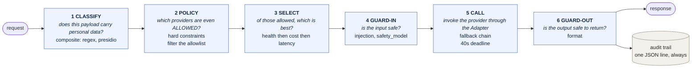
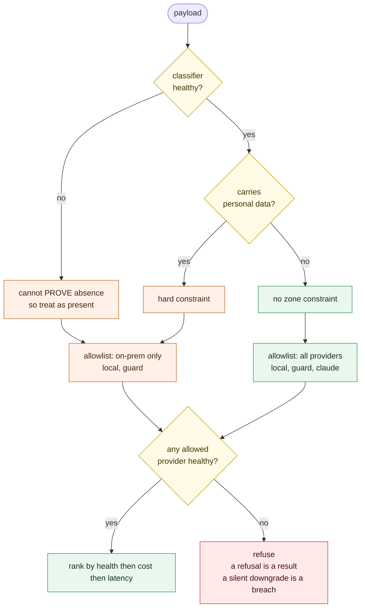
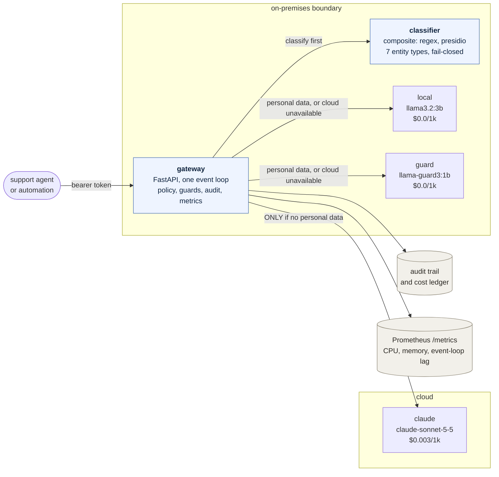
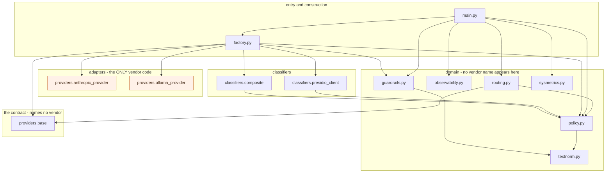

# LLM Governance Plane

[](https://github.com/HemantVarhekar/llm-governance-plane/actions/workflows/evidence.yml)

A control plane that sits in front of every machine-learning and
large-language-model call, so each one is **observable, guard-railed,
cost-routed, compliance-bound and fallback-protected** — and so every
decision it made can be proved afterwards.

```bash
python prove.py          # run every gate and write the evidence catalogue
```

> **On the worked example.** The scenario below is DIRECTV migrating
> subscribers from satellite to streaming. **Every figure comes from public
> third-party analysis — nothing internal, and each one is confidence-labelled
> in [BUSINESS_CASE.md](BUSINESS_CASE.md).** It is there to make the
> engineering concrete; the control plane itself is industry-agnostic.

---

## The problem I set out to fix

DIRECTV's winning move is operational: hold the subscribers you have,
and move them to streaming without losing them in transit. Churn scoring,
playback anomaly detection, support drafting — all of it now runs through an
ML or LLM call, and every one of those calls touches customer data.

The risk isn't that a model gets something wrong. It's that **you can't prove
what it did** — whose data went where, why a provider was allowed to see it,
and whether the guardrails were even switched on at the time.

That last one isn't hypothetical. During this build, a gateway ran for eight
hours with its guardrails silently unloaded. Every test passed — because every
test ran in-process, and not one of them ever asked the live service what it
had actually loaded. Closing that gap is the entire point of this system.

## What this is

A control plane in front of every model call. Personal data is a **hard
constraint**: it filters the provider list before cost or latency are
considered — and if the detector is unavailable, cloud egress is refused
rather than assumed safe. Safety without an outage.

The gateway itself is a commodity; I'd buy one. The part worth building is the
**evidence layer** — the adversarial corpus, the promotion gates, the
traceability, the audit trail that answers *why* a model made a given decision
about a customer.

---

## What it proves

| Measure | Result |
|---|---|
| Personal data reaching cloud under load | **0** |
| False alarms on real customer messages | **0 of 136** |
| Hand-written adversarial prompts held | **988 of 1,000** (976 by patterns alone) |
| Model-generated attacks held | **49 of 50** |
| Personal-data detector | F1 **1.000** — the gate refuses **2 of every 3** candidates |
| Tests | **159**, hermetic, green in CI on every push |
| Scenario coverage | **23 of 23**, traced from code and spec |
| Published figures | **44 of 44**, asserted against their source runs |

### Coverage, by discipline

Every test carries a discipline marker — none are uncategorised — and every
one runs on every push.

| Discipline | Scenarios | Tests | What it proves | In CI |
|---|---|---|---|---|
| Governance | 6 | 25 | Data residency, auditability, refusal behaviour, fail-closed on classifier loss | ✅ |
| Security | 5 | 63 | Auth, caller override, prompt injection, obfuscation, timing side-channel | ✅ |
| Performance | 3 | 32 | Chain deadlines, load shedding, latency bounds, saturation | ✅ |
| Quality | 1 | 15 | Output drift, reply-format guardrails, detector promotion gate | ✅ |
| Cost | 2 | 7 | Routing economics and the cost ledger | ✅ |
| Resilience | 2 | 7 | Fallback chains, error taxonomy, graceful degradation | ✅ |
| Architecture | 2 | 3 | Adapter / Factory / Strategy guarantees, enforced vendor boundary | ✅ |
| Reliability | 1 | 5 | Startup configuration validation | ✅ |
| Operability | 1 | 3 | Live config reload without restart | ✅ |

Counts sum to 160 against 159 unique tests: one test is deliberately both
`security` and `performance`, because an oversized payload is a
denial-of-service vector *and* a latency concern.

### Gates that also run on every push

| Gate | Scale | What it enforces |
|---|---|---|
| Red team, hand-written | 1,000 attacks | Prompt injection, credential extraction, authority pretexting, obfuscation |
| Red team, model-generated | 50 curated | Attacks the model invented — curated and frozen for reproducibility |
| Detector promotion gate | 3 candidates, 185 samples | No detector below threshold can be promoted |
| Figure verification | 44 assertions | Every published number checked against its source run |
| Architecture drift | 4 diagrams + 1 invariant | Diagrams regenerated from config and the import graph; no vendor name appears outside the adapter layer |

Three gates are reported as **not** covered by CI, because they need a live
service or wall-clock time: the deployment preflight, the load test and the
longevity soak. CI marks them skipped **with the reason**, rather than
counting them as passes.

---

## Cost — two numbers, not to be confused

| Figure | Amount | What it is |
|---|---|---|
| **The prize** | **$148–172M / yr** | Revenue retained by a 1% churn reduction on ~8.2M subscribers. This system doesn't deliver that — it makes the programme that does safe to run on customer data |
| Inference saving | ~$74K / yr | Two-thirds of 12.3M yearly contacts kept on-prem. Real, and small — I wouldn't fund this on cost arbitrage |
| Production run cost | ~$180K / yr | 2 GPU nodes, observability, 0.5 FTE. Illustrative, not a quote |

The case is risk and optionality: when a provider raises prices or degrades,
switching is a config line, not a release.

## Stack — architecture-correct, scale-simulated

| | POC today | Production |
|---|---|---|
| Drafting | `llama3.2:3b`, Ollama, on-prem | GPU inference nodes |
| Safety | `llama-guard3:1b`, on-prem | Same, replicated |
| Cloud | `claude-sonnet-5-5` ($0.003/1k) | Unchanged — swappable by config |
| PII detection | Presidio + spaCy, single process | Replicated — the measured bottleneck at 2.9 req/s |
| Service | FastAPI / Python 3.13, one node | Managed Kubernetes, GitOps, OPA |
| Observability | 107 Prometheus metrics + audit trail | + Grafana, per-segment cost attribution |
| Security testing | 1,000-attack corpus in CI | + garak, PyRIT, mTLS, workload identity |
| Load testing | k6 2.3.0, 3 scenarios, thresholds as code | k6 in CI against this baseline |
| Hardware | One laptop, 2 cores | Multi-region, stated RTO/RPO |

**Time to production: 8 weeks — 2 engineers and 1 QA lead.** Every item in that
plan comes from something measured: the classifier replica count comes from a
measured 2.9 req/s ceiling, not a guess.

---

## Prove it

Everything is runnable. `prove.py` runs every gate and writes
`evidence/catalogue.json`, `.md` and `.txt`.

```bash
python prove.py                    # everything needing no running service
python prove.py --full             # also preflight and the load test
python prove.py --category security
```

A check reports one of four outcomes, and they are kept apart:

| | |
|---|---|
| `PASS` | ran, and met its criterion |
| `FAIL` | ran, and did not |
| `SKIP` | **could not run, and says why** |
| `ERROR` | the check itself broke |

A harness that folds `SKIP` into `PASS` is how a suite comes to report green
while proving nothing. That is not hypothetical here — see the findings below.

CI runs **this same command**, so what passes on every push is the thing
demonstrated in a room, not a parallel pipeline that drifts from it.

---

## Architecture

<!-- ARCHITECTURE:BEGIN - generated by architecture.py, do not edit -->

### The request path

Every call takes the same six stages.



### The decision at stage 2

This is the one the system exists to make, so it gets its own picture rather than four arrows crowding the diagram above. **Personal data filters the provider list before cost or latency are consulted.** A preference can be outvoted; a constraint cannot.



Constraints in force, read from `policy.yaml`:

- **`pii_stays_onprem`** - when `has_pii: True`, require zone `onprem`
- **`fail_closed_when_classifier_down`** - when `classifier_healthy: False`, require zone `onprem`

The second is the one worth pausing on. If the classifier is unreachable the gateway cannot *prove* a payload is free of personal data, and inability to prove absence is treated as presence. The subscriber is still served, on-premises. Safety without an outage.

### Deployment

2 providers on-premises, 1 in cloud, and a classifier that gates the boundary.



### Modules, parsed from the imports

Not drawn. This is the real import graph of 7 modules.



**The Adapter boundary holds.** No module outside `factory.py` and the providers package imports a concrete provider - not `main.py`, not `routing.py`, not `policy.py`. `routing.py` depends only on `policy` and `providers/base`, so it orders and falls back between providers it knows nothing about. That is what makes swapping a model a configuration line rather than a release, and `architecture.py --check` fails the build if it ever stops being true.

_All four diagrams are generated by `architecture.py` from `config.yaml`, `policy.yaml` and the import graph. CI runs `--check` and fails if they drift._

<!-- ARCHITECTURE:END -->

## Findings

The interesting output of this project is the defects, including the ones in
its own instruments.

**The deployed gateway had no guards switched on.** A process left running for
eight hours predated the guard wiring and answered *"ignore all previous
instructions"* while every in-process test passed. The red team ran
in-process, so nothing ever asked the live service whether it had guards
loaded. Fixed by `loadtest/preflight.py`, which compares the *running* service
against its configuration and sends a canary through the real HTTP path.

**The safety model blocked 66% of real customers.** Every message containing a
name or an address came back as hazard S7, "Privacy". The model was right; it
is just useless as a gate, because that describes most support traffic. Two
controls had overlapping scope and the cruder one was vetoing the classifier
that already owned the decision. S7 is now advisory — still audited, no longer
blocking. False alarms 66% → 0%, attack detection unchanged, compliance-path
median 23.5s → 10.2s.

**The control plane is saturated at concurrency 1.** Throughput is flat at
about 3.1 per second from 1 to 16 concurrent while latency grows linearly.
Little's law holds within 2–8% at every rung, so the plateau is real rather
than a harness artefact. The cause is one event loop on one core while three
sit idle — a configuration fix, now measurable against a baseline.

**My own metrics were missing the biggest consumer on the machine.** Host CPU
peaked at 100% while the per-process breakdown explained a quarter of it, and
Ollama reported 78MB for a loaded three-billion-parameter model. The model
runner is a separate executable that did not match the name pattern: 3.7GB and
nearly all the inference CPU were invisible. The breakdown now publishes
`mg_host_cpu_unattributed_percent`, so a gap of this kind sets off its own
alarm instead of inviting a confident wrong answer.

**An aggregate threshold hid a 71% failure rate.** One path failed 5 of 7
requests while the run reported all thresholds passed, because those 5 were
1.25% of 400 total. The busiest scenario was voting on behalf of the quietest.
Thresholds are now per scenario as well as global.

**Five tests passed only because a service happened to be running.** They had
an undeclared dependency on the classifier; on a clean machine they failed.
The suite is now hermetic.

More in [PERFORMANCE-FINDINGS.md](PERFORMANCE-FINDINGS.md) and
[redteam/FINDINGS.md](redteam/FINDINGS.md).

---

## Known gaps

Stated first, because they would be asked anyway.

- No multi-turn attacks yet
- The output path is more lightly tested than the input path
- **No longevity test** — five minutes can't tell a memory leak from a cache
  settling, and one component drifted 91MB in that window
- The evaluation dataset was written by the same person who wrote the guards
- garak and PyRIT were not run
- Runs on a laptop: **architecture-correct, scale-simulated**. The shape of the
  findings holds; the absolute numbers are two-core numbers
- On-premises with a *real* cloud model provider — **not** a hybrid cloud
  deployment, and never described as one
- The churn model is a deliberate stand-in

---

## Layout

| | |
|---|---|
| `llm-gateway/` | the service: policy, routing, guardrails, providers, metrics |
| `redteam/` | adversarial corpora, the runner, and the findings |
| `evals/` | evaluation harness, promotion gate, model registry |
| `loadtest/` | k6 scenarios, the runner, the preflight and the soak |
| `dashboard/` | evidence page, collectors, and the figure verifier |
| `prove.py` | one command that runs every gate |
| `architecture.py` | regenerates the diagrams below and enforces the vendor boundary |
| `SCENARIOS.md` | the scenario catalogue the tests are traced against |
| `ARCHITECTURE.md` | how it is put together, and why |

## Running it

```bash
pip install -r llm-gateway/requirements.txt
python -m spacy download en_core_web_sm
```

```bash
cd llm-gateway && uvicorn main:app --port 8000
```

[DEMO.md](DEMO.md) has the full sequence, including the failure
demonstrations — killing the classifier mid-request to show the gate fail
closed rather than fail open.
